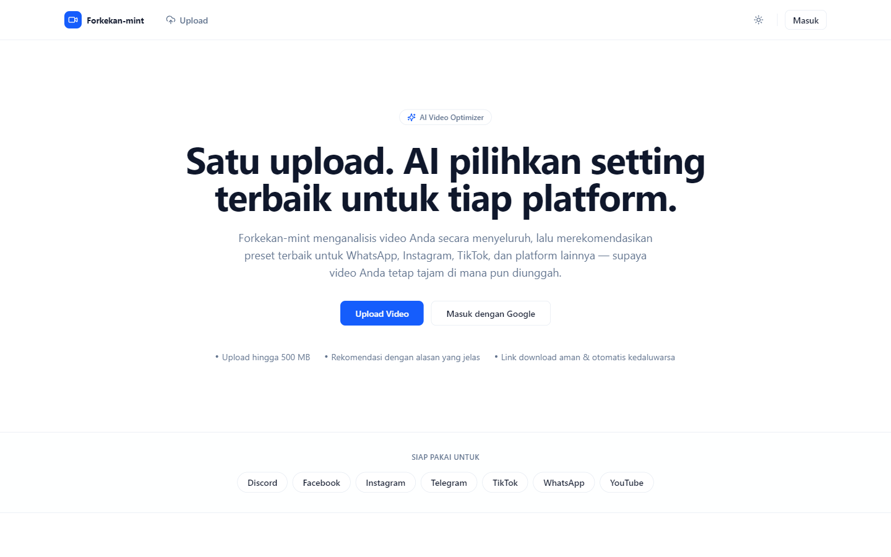
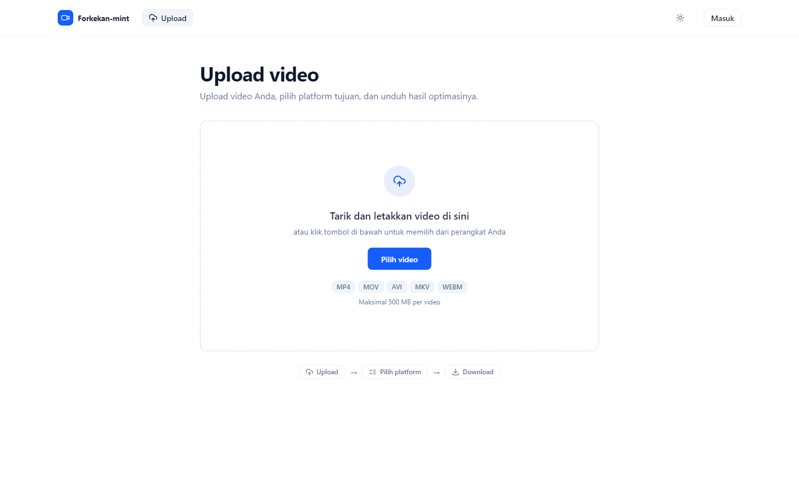
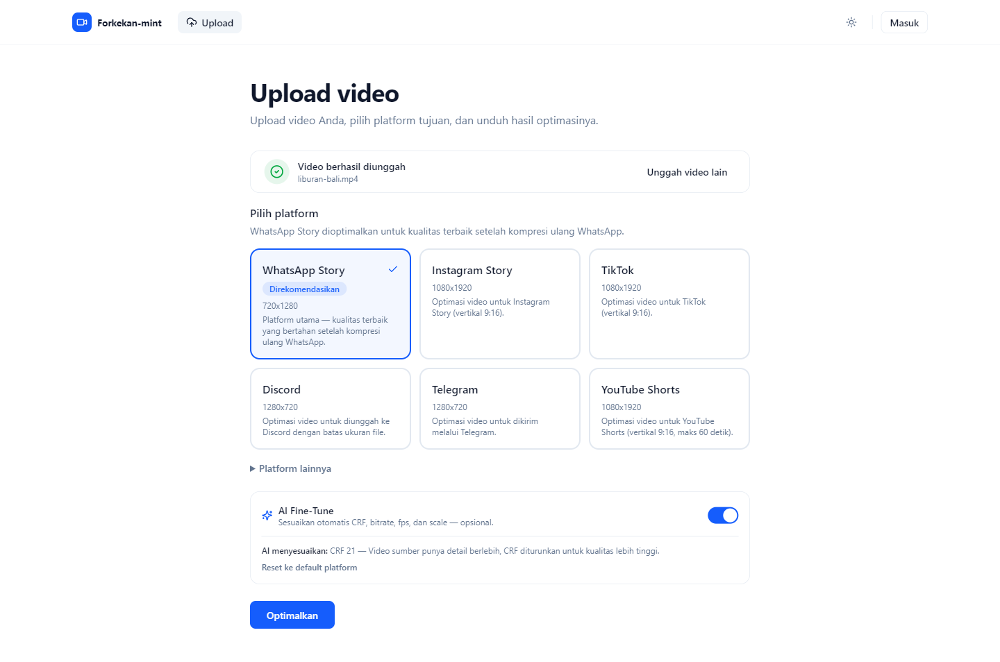
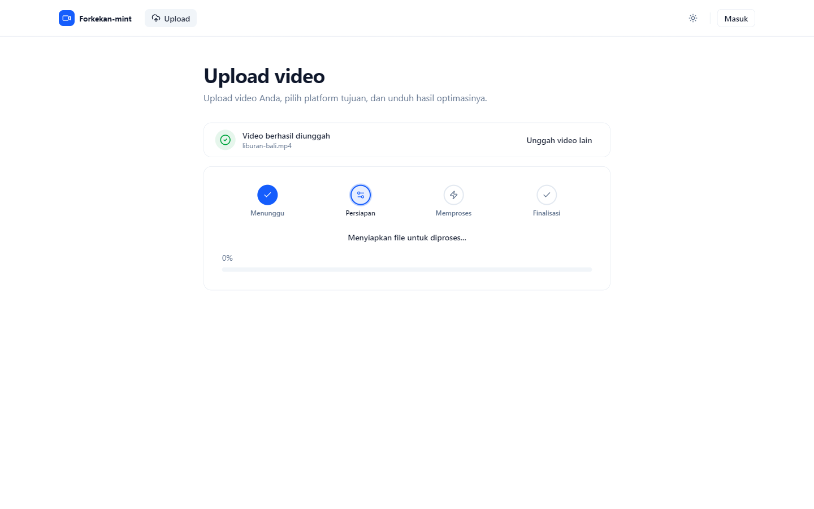
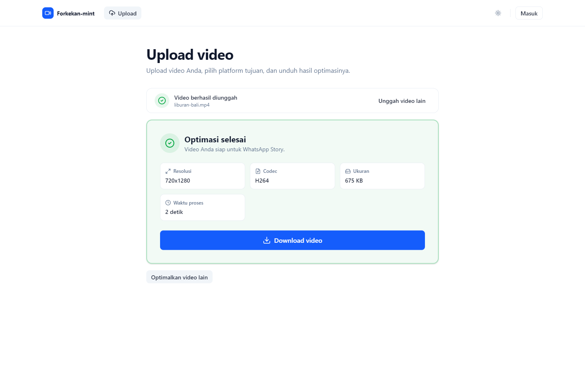
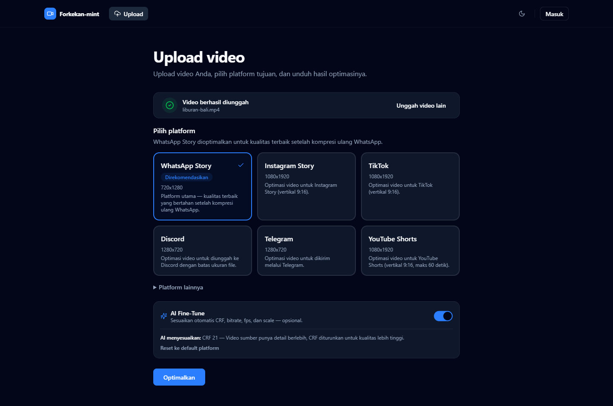
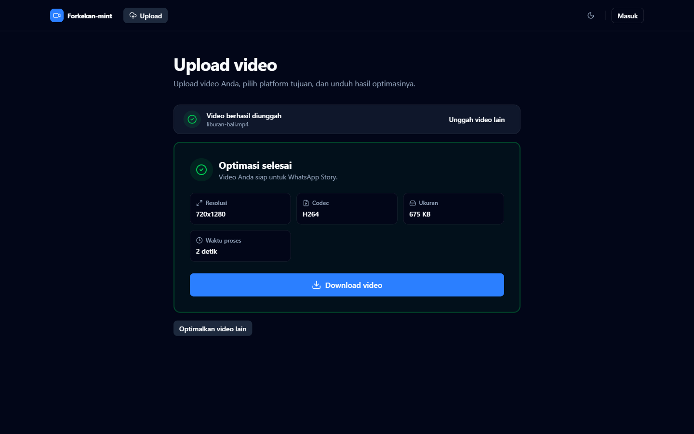

# Forkekan-mint

> Anti Video Burik.
>
> "4K kan min!"

Monorepo untuk Forkekan-mint — aplikasi optimasi video agar tidak "burik" saat diunggah ke berbagai platform.

<picture>
  <source media="(prefers-color-scheme: dark)" srcset=".github/assets/screenshots/landing-dark.png">
  
</picture>

## Fitur

- **Rekomendasi AI** — video dianalisis lalu diberi skor kecocokan per platform, lengkap dengan alasannya.
- **Preset multi-platform** — WhatsApp, Instagram, TikTok, Telegram, Discord, YouTube Shorts, Facebook, dan lainnya.
- **AI Fine-Tune (opsional)** — CRF, bitrate, fps, dan scale disesuaikan otomatis dengan karakter video sumber.
- **Proses di background** — antrean BullMQ + FFmpeg dengan progress real-time.
- **Upload hingga 500 MB** — mendukung MP4, MOV, AVI, MKV, dan WEBM.
- **Download aman** — link download sementara yang kedaluwarsa otomatis.
- **Riwayat & admin dashboard** — riwayat optimasi untuk user login, panel admin untuk jobs, users, dan presets.
- **Dark mode** — mengikuti preferensi sistem atau dipilih manual.

## Screenshots

### Alur optimasi

|                            1. Upload video                            |                                          2. Pilih platform & AI Fine-Tune                                          |
| :-------------------------------------------------------------------: | :----------------------------------------------------------------------------------------------------------------: |
|         |  |
|                        **3. Proses optimasi**                         |                                             **4. Hasil siap diunduh**                                              |
|  |                                        |

### Dark mode

|                                          Pilih platform                                          |                                Hasil optimasi                                 |
| :----------------------------------------------------------------------------------------------: | :---------------------------------------------------------------------------: |
|  |  |

## Tech Stack

| Layer    | Teknologi                                                                            |
| -------- | ------------------------------------------------------------------------------------ |
| Frontend | React 19, Vite, TypeScript, Tailwind CSS v4, shadcn/ui, TanStack Query, React Router |
| Backend  | NestJS, Prisma, PostgreSQL, JWT Authentication                                       |
| Worker   | BullMQ, Redis, FFmpeg                                                                |
| Storage  | Cloudflare R2                                                                        |
| Tooling  | pnpm workspace, Turborepo, ESLint, Prettier, Husky, Commitlint                       |

## Struktur Workspace

```text
forkekan-mint/
├── apps/
│   ├── web/        # Frontend (React + Vite)
│   ├── api/        # Backend (NestJS + Prisma)
│   └── worker/     # Background processing (BullMQ + FFmpeg)
├── packages/
│   ├── ui/         # Shared UI components
│   ├── types/      # Shared TypeScript types
│   ├── config/     # Shared configuration
│   ├── eslint/     # Shared ESLint config
│   ├── tsconfig/   # Shared tsconfig presets
│   └── shared/     # Shared utilities (formatter, validator, constants)
├── docs/           # Dokumentasi proyek
├── infra/          # Docker, Nginx, Coolify, Compose
├── scripts/        # Automation scripts
└── .github/        # CI/CD workflows & templates
```

## Prasyarat

- Node.js `>= 20.19`
- pnpm `>= 10`
- Docker (untuk PostgreSQL & Redis lokal)
- FFmpeg (untuk worker, mulai Phase 4)

## Getting Started

```bash
# 1. Install dependencies
pnpm install

# 2. Siapkan environment
cp .env.example .env

# 3. Jalankan PostgreSQL & Redis (opsional untuk Phase 1)
docker compose up -d

# 4. Generate Prisma Client
pnpm db:generate

# 5. Jalankan seluruh aplikasi (web + api + worker)
pnpm dev
```

| Service | URL                          |
| ------- | ---------------------------- |
| Web     | http://localhost:3000        |
| API     | http://localhost:4000/api/v1 |

## Scripts

| Perintah                 | Deskripsi                                  |
| ------------------------ | ------------------------------------------ |
| `pnpm dev`               | Jalankan semua app dalam mode development  |
| `pnpm build`             | Build semua app                            |
| `pnpm lint`              | Lint semua workspace                       |
| `pnpm typecheck`         | Type-check semua workspace                 |
| `pnpm test`              | Jalankan test semua workspace              |
| `pnpm format`            | Format kode dengan Prettier                |
| `pnpm db:generate`       | Generate Prisma Client                     |
| `pnpm db:migrate`        | Jalankan migrasi database (development)    |
| `pnpm db:migrate:deploy` | Terapkan migrasi tanpa prompt (production) |
| `pnpm db:seed`           | Isi data awal (Platform Presets)           |

## Production Deployment

Lihat [DEPLOYMENT.md](DEPLOYMENT.md) untuk panduan deployment production lengkap (Docker Compose, environment variable wajib, migration, HTTPS, checklist, dan rollback). Strategi arsitektural lengkap ada di [docs/11-deployment.md](docs/11-deployment.md).

```bash
cp .env.example .env   # isi seluruh nilai — lihat DEPLOYMENT.md §3
docker compose -f infra/compose/docker-compose.prod.yml build
docker compose -f infra/compose/docker-compose.prod.yml run --rm api pnpm --filter @forkekan/api db:migrate:deploy
docker compose -f infra/compose/docker-compose.prod.yml up -d
```

## Dokumentasi

Seluruh blueprint proyek ada di folder [docs/](docs/), mulai dari product overview hingga testing strategy.

## Konvensi

- Commit mengikuti [Conventional Commits](https://www.conventionalcommits.org/) (divalidasi commitlint + husky).
- Folder `lowercase`, file `kebab-case`, komponen `PascalCase`.
- Gunakan absolute import (`@/...`), hindari relative import yang panjang.

## License

[MIT](LICENSE)
