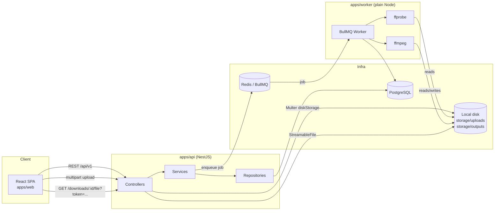
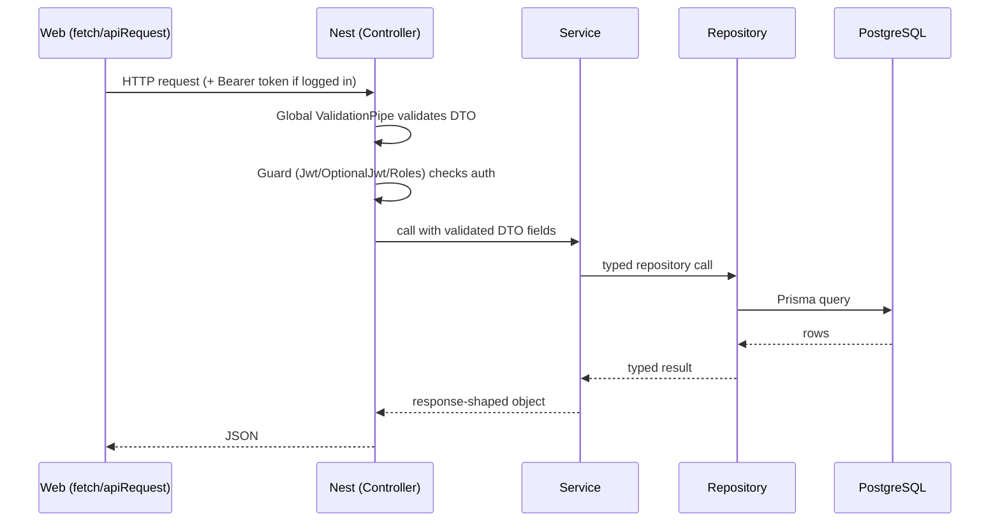
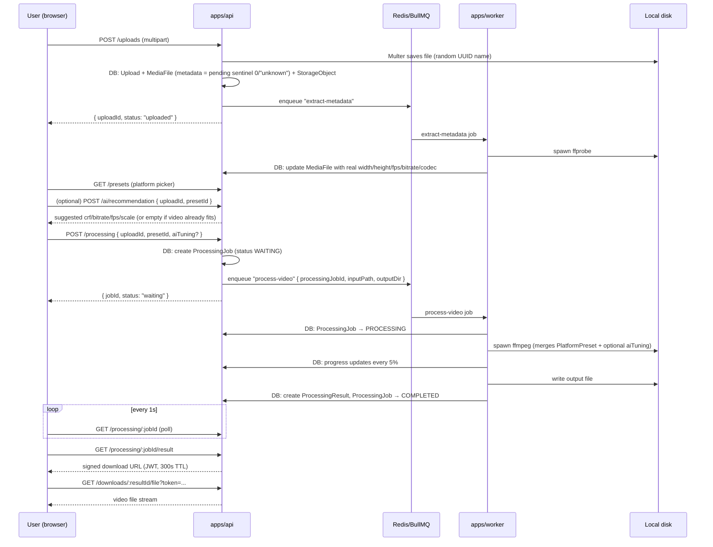

# 01 — Project Overview

> Generated by codebase analysis. Read-only documentation — reflects the code as it exists today, not the aspirational blueprint in `docs/`. Where the two disagree, this is called out explicitly (see [10-quality-review.md](./10-quality-review.md)).

## What this project is

**Forkekan-mint** ("Anti Video Burik" / "4K kan min!") is a video-optimization web app. A user uploads a video, picks a target platform (WhatsApp Story by default), optionally lets a deterministic rules engine fine-tune a few encode parameters, and downloads a re-encoded file sized and shaped for that platform.

The product recently pivoted (see the git history around the `platform-picker`/`ai-fine-tune-toggle` components) from "AI recommends the best platform for your video" to **"WhatsApp Story is the primary, pre-selected product; AI is an optional fine-tuning assistant on top of whatever platform you pick."** This is visible throughout the code: `DEFAULT_PLATFORM_SLUG = 'whatsapp-story'` in [apps/web/src/components/optimize-panel.tsx](../../apps/web/src/components/optimize-panel.tsx#L28), the "Direkomendasikan" badge in [platform-picker.tsx](../../apps/web/src/components/platform-picker.tsx#L59), and the CRF-mode WhatsApp Story seed entry in [apps/api/prisma/seed.ts](../../apps/api/prisma/seed.ts#L65-L82).

## Main goal

Take a source video of arbitrary resolution/bitrate/codec and re-encode it so that:
1. It fits the target platform's technical envelope (resolution, fps, container, codec).
2. It survives the platform's *own* re-compression (WhatsApp specifically) with as little visible quality loss as possible.
3. The user does this with the fewest possible decisions — upload, pick platform (or accept the default), optionally flip one AI toggle, download.

## Tech stack

| Layer | Technology |
|---|---|
| Backend API | NestJS 11, Prisma 6 (`@prisma/client` 6.8), PostgreSQL |
| Queue | BullMQ 5 on Redis (`ioredis`) |
| Worker | Plain Node.js (no framework) + BullMQ `Worker`, spawns `ffmpeg`/`ffprobe` as child processes |
| Frontend | React 19, Vite 6, TanStack Query 5, React Router 7, Tailwind CSS 4, Zustand 5 |
| Auth | Google OAuth ID token verification (`google-auth-library`) → app-issued JWT (`@nestjs/jwt`) |
| Monorepo | pnpm workspaces + Turborepo |
| Validation | `class-validator` / `class-transformer` DTOs, NestJS global `ValidationPipe({ whitelist: true, transform: true })` ([apps/api/src/main.ts](../../apps/api/src/main.ts#L28-L33)) |
| Testing | Jest (api), Vitest (worker, web) |

There is **no LLM, no external AI API, no Gemini integration anywhere in the codebase.** "AI Recommendation" and "AI Fine-Tune" are both a deterministic, weighted-scoring TypeScript module — see [06-ai.md](./06-ai.md).

## Monorepo structure

```
forkekan-mint/
├── apps/
│   ├── api/        NestJS REST API (HTTP boundary, DB writes, queue producer)
│   ├── worker/      BullMQ consumer — ffprobe + ffmpeg execution (queue consumer)
│   └── web/         React SPA
├── packages/
│   ├── types/       shared TS types (currently empty — `export {}`, unused)
│   ├── shared/       APP_NAME / APP_TAGLINE constants
│   ├── ui/           placeholder (not populated with real components)
│   ├── config/       placeholder
│   ├── tsconfig/     shared tsconfig bases
│   └── eslint/       shared eslint config
└── docs/             the blueprint (product/architecture spec docs read by CLAUDE.md)
```

`apps/api` and `apps/worker` never call each other directly — they only communicate through **PostgreSQL** (shared `ProcessingJob`/`MediaFile` rows) and **Redis/BullMQ** (job queue). This is the one hard architectural seam in the system.

## Overall architecture



Storage is **local disk only** — `apps/api/src/uploads/uploads.constants.ts` (`DEFAULT_UPLOAD_DIR = 'storage/uploads'`) and `apps/api/src/processing/processing.constants.ts` (`DEFAULT_OUTPUT_DIR = 'storage/outputs'`). There is a `StorageObject` Prisma model with a `disk`/`bucket` field suggesting an eventual Cloudflare R2 target, but nothing in the code touches any cloud storage SDK — see [08-database.md](./08-database.md) and [10-quality-review.md](./10-quality-review.md).

## Request flow (generic HTTP request)



Every module in `apps/api` follows Controller → Service → Repository strictly (see [03-backend.md](./03-backend.md) for the full trace of every module). Controllers never touch Prisma directly.

## Video processing flow (the core product loop)



Full detail in [04-worker.md](./04-worker.md) and [05-ffmpeg.md](./05-ffmpeg.md).

## Queue flow

A single BullMQ queue, `video-processing` (constant duplicated in both apps — [apps/api/src/common/queue/queue.constants.ts](../../apps/api/src/common/queue/queue.constants.ts) and [apps/worker/src/jobs/queue-names.ts](../../apps/worker/src/jobs/queue-names.ts) — kept manually in sync, no shared package used despite `packages/types` existing for exactly this purpose), carries two distinct job types dispatched by name inside one worker process:

- `extract-metadata` — runs after every upload, populates `MediaFile` from ffprobe.
- `process-video` — runs after the user clicks "Optimalkan", runs ffmpeg.

`VideoProcessingQueueService.add()` ([apps/api/src/common/queue/video-processing-queue.service.ts](../../apps/api/src/common/queue/video-processing-queue.service.ts#L37-L46)) never throws on a Redis outage — it catches, logs, and returns `false`. Callers decide the consequence: `MetadataQueueService` silently swallows it (metadata just stays pending forever), `ProcessingService.createJob` marks the just-created job `FAILED` and returns `503`.

## AI flow

See [06-ai.md](./06-ai.md) for full detail. In one sentence: `POST /ai/recommendation` is a single endpoint with two modes selected by the presence of `presetId` in the body — omitted it ranks all 9 presets (legacy, still implemented, no longer called by the frontend); provided it returns a small deterministic delta (`suggestedCrf`/`suggestedBitrate`/`suggestedFps`/`suggestedScale`) computed by [apps/api/src/ai/recommendation.engine.ts](../../apps/api/src/ai/recommendation.engine.ts) against the one preset already chosen. AI never touches — and cannot touch — codec, container, audio settings, or which preset is used.

## Download flow

Downloads are never served directly by filename. `GET /processing/:jobId/result` and `GET /downloads/:resultId` both return a **signed URL**: a short-lived (300s) JWT with `purpose: "download"` embedded in the query string (`?token=...`), verified again on `GET /downloads/:resultId/file`. See [apps/api/src/downloads/downloads.service.ts](../../apps/api/src/downloads/downloads.service.ts). If a logged-in user requests the URL, a `Download` row is recorded (best-effort — failure to record doesn't fail the request, [downloads.service.ts:64-68](../../apps/api/src/downloads/downloads.service.ts#L64-L68)); guests download without any history trace.

## What's documented but not implemented

Two things in `docs/07-api-specification.md` have no corresponding code at all:
- `GET /videos/{id}/analysis` — no `videos` module exists.
- `GET/POST/DELETE /favorites` — no `favorites` module exists, despite the `FavoritePreset` Prisma model existing and being fully wired into the schema (`User.favorites`, `PlatformPreset.favorites`).

See [10-quality-review.md](./10-quality-review.md) for the full list of doc/code drift.
