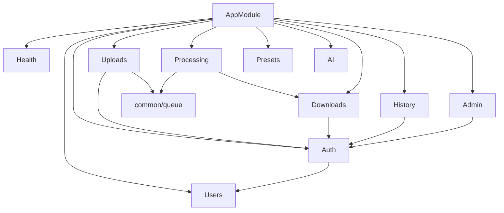

# 03 — Backend (apps/api)

NestJS 11 app, global prefix `/api/v1` ([apps/api/src/main.ts](../../apps/api/src/main.ts#L26)). Every module follows **Controller → Service → Repository**; controllers contain no business logic, repositories contain no business logic (only Prisma calls), services contain everything else. This is the one architectural rule that holds with zero exceptions across all 10 modules.

## Module graph

## Global request pipeline

Set up once in [main.ts](../../apps/api/src/main.ts):
1. `helmet()` with `crossOriginResourcePolicy: 'cross-origin'` (needed because the SPA and API can be on different origins).
2. `compression()`.
3. `app.setGlobalPrefix('api/v1')`.
4. `ValidationPipe({ whitelist: true, transform: true })` globally — every DTO with `class-validator` decorators is enforced on every request; unknown fields are stripped (`whitelist`), primitives are coerced to their declared types (`transform`, e.g. query-string numbers become `number`).
5. CORS: `origin: process.env.CORS_ORIGIN ?? 'http://localhost:3000'`, `credentials: true`.
6. `RequestLoggerMiddleware` applied to every route via `AppModule.configure()` ([app.module.ts:55-57](../../apps/api/src/app.module.ts#L55-L57)).
7. Global `ThrottlerGuard` (rate limiting), config from `RATE_LIMIT_TTL_MS`/`RATE_LIMIT_LIMIT` env vars, default 120 requests / 60s.
8. `app.set('trust proxy', 1)` — trusts one reverse-proxy hop for `req.ip`.

## Auth (`src/auth/`)

- `POST /auth/google` → `AuthController.loginWithGoogle` → `AuthService.loginWithGoogle(idToken)`:
  1. `GoogleAuthService.verifyIdToken` calls `OAuth2Client.verifyIdToken` against `GOOGLE_CLIENT_ID`. Throws `UnauthorizedException` if the client ID isn't configured or the token doesn't verify.
  2. `UsersService.upsertGoogleUser(profile)` — upsert by `providerId`.
  3. Signs a JWT with `{ sub, email, role }` ([auth.service.ts:42-48](../../apps/api/src/auth/auth.service.ts#L42-L48)).
- `GET /auth/me` — `JwtAuthGuard`-protected, returns the current user's profile including `role`.
- `POST /auth/logout` — a no-op that returns `{ success: true }`; the comment explicitly notes JWT is stateless, so "logout" is purely a client-side token discard ([auth.controller.ts:29-31](../../apps/api/src/auth/auth.controller.ts#L29-L31)). There is no token blocklist/revocation anywhere.
- **Three guards**, all in `src/auth/guards/`:
  - `JwtAuthGuard` — requires `Authorization: Bearer <token>`, throws `401` if missing/invalid.
  - `OptionalJwtAuthGuard` — no header → passes through as guest (`request.user` undefined); a header that's present but invalid still throws `401` (you can't silently degrade an explicitly-sent bad token).
  - `RolesGuard` — reads `@Roles(UserRole.ADMIN)` metadata via `Reflector`, must run *after* a Jwt guard since it reads `request.user.role`.
- JWT config: `JWT_SECRET` (required, fail-fast validated — see below), `JWT_EXPIRES_IN` defaulting to `'7d'` ([auth.module.ts:17-26](../../apps/api/src/auth/auth.module.ts#L17-L26)).

## Uploads (`src/uploads/`)

- `POST /uploads`, `OptionalJwtAuthGuard`, `FileInterceptor('video')`.
- Multer is configured in the **module**, not the service ([uploads.module.ts](../../apps/api/src/uploads/uploads.module.ts)): `diskStorage` writes to `UPLOAD_DIR` (default `storage/uploads`) with a random-UUID filename preserving the original extension; `fileFilter` rejects anything whose extension+mimetype pair isn't in `ALLOWED_VIDEO_TYPES` (mp4/mov/avi/mkv/webm); `limits.fileSize` enforces `MAX_UPLOAD_SIZE_BYTES` (500 MB).
- `UploadsService.createUpload`:
  1. Rejects if no file (`BadRequestException`).
  2. `UploadsRepository.createUploadedVideo` — **one Prisma call** creates `Upload` + nested `MediaFile` + nested `StorageObject` atomically (Prisma nested writes, implicitly transactional). Metadata fields (`width`, `height`, `duration`, `fps`, `bitrate`, `codec`, `audioCodec`, `audioBitrate`) are all written as **sentinel values** (`0` / `"unknown"`, from `METADATA_PENDING_NUMBER`/`METADATA_PENDING_CODEC`) — ffprobe hasn't run yet.
  3. Enqueues `extract-metadata` via `MetadataQueueService`.
  4. **On any error after the file is written to disk**, `unlink(file.path)` cleans up the orphan file ([uploads.service.ts:71-77](../../apps/api/src/uploads/uploads.service.ts#L71-L77)) — this is the one place in the codebase with explicit compensating cleanup logic.
- `GET /uploads/:id` — plain detail lookup, no guard (public).

## Processing (`src/processing/`)

The core write path. `POST /processing` → `ProcessingController.create` → `ProcessingService.createJob(uploadId, presetId, aiTuning?)`:

1. `findUploadWithMedia` — 404 if upload missing, 400 if it has no `MediaFile` yet.
2. `findPresetById` — 404 if the preset id doesn't exist.
3. `findActiveJob(mediaFileId, presetId)` — if a job for this exact media+preset pair is already `WAITING` or `PROCESSING`, throws `409 ConflictException` ("Video ini sedang diproses dengan preset yang sama"). This is a **duplicate-submission guard, not a general one-job-per-video lock** — the same video can have concurrent jobs for *different* presets.
4. `createJob` — inserts a `ProcessingJob` row (`status: WAITING`, `progress: 0`, `aiTuning` serialized via `JSON.parse(JSON.stringify(dto))` to strip it to a plain object safe for Prisma's `Json` column, or `Prisma.JsonNull` if omitted).
5. Enqueues `process-video` with `{ processingJobId, inputPath, outputDir }` — note **the input path is computed here** (`path.join(uploadDir, mediaFile.storedFilename)`), not stored on the job row; if `UPLOAD_DIR` ever changes between when a job is queued and when the worker picks it up, this string is still what gets used.
6. If enqueueing fails (queue producer returns `false`, e.g. Redis down), the just-created job is immediately marked `FAILED` and the request returns `503`. **This leaves a `FAILED` `ProcessingJob` row in the DB with no corresponding queue job ever having existed** — a client retry with the same params will succeed on a second attempt but a duplicate `ProcessingJob` row remains from the first.

`GET /processing/:jobId` → `getStatus`:
- Maps DB `JobStatus` (`WAITING`/`PROCESSING`/`COMPLETED`/`FAILED`) to a **derived, richer** `currentStep` string ([processing.service.ts:190-198](../../apps/api/src/processing/processing.service.ts#L190-L198)): `PROCESSING` with `progress === 0` → `"Preparing"`; `PROCESSING` with `progress >= 90` → `"Finalizing"`; otherwise `"Encoding"`. There is no `Optimizing`/`Generating Preview` step despite `docs/03-user-flow.md` describing them — see [10-quality-review.md](./10-quality-review.md).
- `estimatedRemaining` is a **naive linear extrapolation**: `elapsedMs / progress * (100 - progress)`, only computed while `PROCESSING` and `progress > 0` ([processing.service.ts:204-215](../../apps/api/src/processing/processing.service.ts#L204-L215)).

`GET /processing/:jobId/result` → `getResult`:
- 404 if the job or its `ProcessingResult` doesn't exist yet.
- Calls `DownloadsService.createSignedDownload(resultId, null)` — **always passes `userId: null`**, meaning hitting the result endpoint never records a `Download` history row even for a logged-in user; only calling `GET /downloads/:resultId` directly (which the frontend's `useDownloadResult`/history page actually does — see [07-frontend.md](./07-frontend.md)) attributes a download to a user.
- `humanFileSize` converts the `BigInt` `outputSize` to a string like `"18 MB"`.

## AI (`src/ai/`)

See [06-ai.md](./06-ai.md) for the full algorithm. Structurally: `ai.controller.ts` is a single `POST /ai/recommendation` route delegating to `AiService.recommend(uploadId, presetId?)`, which branches into either `rankPresets` (all presets, legacy) or `suggestTuning` (one preset, current default). `AiRepository` has three methods: `findUploadWithMedia`, `findAllPresets`, `findPresetById` — all unfiltered `findMany`/`findUnique`, no `select` narrowing that could accidentally drop a `PlatformPreset` column the tuning logic needs.

## Presets (`src/presets/`)

`GET /presets` — no guard, no params. `PresetsRepository.findAll()` orders by `name asc`. `PresetsService` maps the full `PlatformPreset` row down to `{ id, name, slug, resolution, description }` — this is the **public-facing subset**; the richer encode fields (`crf`, `bitrateStrategy`, `pixelFormat`, `container`, `videoPreset`, `optimizationFlags`, `audioChannels`, `audioSampleRate`, `scalingMode`) are never exposed to the client. The frontend never sees or chooses these — it only ever sends a `presetId` back.

## Downloads (`src/downloads/`)

Two-step signed-URL pattern:
1. `GET /downloads/:resultId` (`OptionalJwtAuthGuard`) → `createSignedDownload`: looks up the `ProcessingResult`, signs a JWT (`{ sub: resultId, purpose: 'download' }`, `expiresIn: 300`) using the **same `JwtService`/`JWT_SECRET`** as session tokens (differentiated only by the `purpose` claim, not a separate signing key), records a `Download` row if `userId` is present (best-effort, swallows errors).
2. `GET /downloads/:resultId/file?token=...` → `streamResultFile`: re-verifies the token, checks `payload.purpose === 'download' && payload.sub === resultId` (so a download token for result A can't be reused for result B even before expiry), checks the file still exists on disk (`existsSync`), streams it via `StreamableFile`. **Content-Type is hardcoded to `video/mp4`** regardless of the actual output container ([downloads.service.ts:109](../../apps/api/src/downloads/downloads.service.ts#L109)) — see [10-quality-review.md](./10-quality-review.md), relevant once any preset other than the current all-mp4 defaults uses `container: 'webm'`/`'mov'`.

## History (`src/history/`)

`JwtAuthGuard`-protected (required, not optional) at the controller level. `GET /history` supports `page`/`limit`/`search`/`platform`/`status`/`sort`/`order` query params via `HistoryQueryDto`. `search` does a case-insensitive `OR` across preset name and original filename. `DELETE /history/:id` — `findJobOwnedByUser` scopes the lookup by `mediaFile.upload.userId === userId` so a user can only delete their own jobs (404, not 403, if they try someone else's — avoids leaking existence). Deleting a job cascades in the DB (`ProcessingResult`/`ProcessingLog` have `onDelete: Cascade` toward `ProcessingJob`) and the service additionally best-effort `unlink`s the output file from disk.

## Admin (`src/admin/`)

Every route: `@UseGuards(JwtAuthGuard, RolesGuard)` + `@Roles(UserRole.ADMIN)` at the controller level ([admin.controller.ts:18-20](../../apps/api/src/admin/admin.controller.ts#L18-L20)). Four read-only endpoints: `dashboard` (counts + total storage bytes across `MediaFile.fileSize` + `ProcessingResult.outputSize`, via a Prisma `$transaction` of two `aggregate` calls), `jobs` (cross-user, filterable by status/worker/search), `storage` (recorded-in-DB usage vs. actual free disk space via Node's `statfs`), `users` (searchable by name/email). No admin endpoint currently exposes the `PlatformPreset` list for **editing** despite `apps/web/src/pages/admin/admin-presets-page.tsx` existing on the frontend — see [07-frontend.md](./07-frontend.md) and [10-quality-review.md](./10-quality-review.md).

There is **no bootstrap mechanism for the first admin user** — `seed.ts`'s own comment states this explicitly ([seed.ts:11-14](../../apps/api/prisma/seed.ts#L11-L14)): role promotion has to happen by hand (direct DB write), there's no CLI/endpoint for it.

## Config / env validation (`src/config/env.validation.ts`)

Runs inside `ConfigModule.forRoot({ validate })`, so a missing `DATABASE_URL` or `JWT_SECRET` throws at boot, not at first request. Also fails boot if `NODE_ENV=production` and `JWT_SECRET` still equals the `.env.example` placeholder value. Every other env var (`REDIS_URL`, `CORS_ORIGIN`, `UPLOAD_DIR`, `OUTPUT_DIR`, `API_PUBLIC_URL`, `RATE_LIMIT_*`) is read ad hoc via `ConfigService.get(key, fallback)` at each call site with an inline default — there's no single source of truth for "every env var this app reads," you'd have to grep for `configService.get`.
