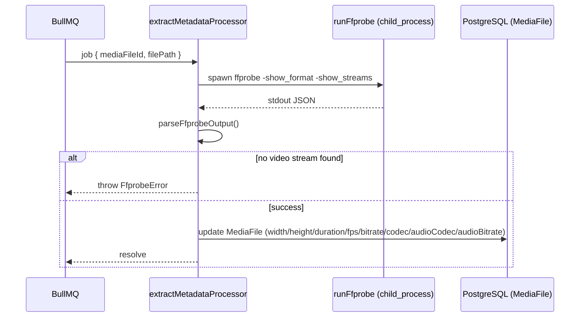

# 04 — Worker (apps/worker)

Plain Node.js process (no framework). One BullMQ `Worker` instance consumes a single queue (`video-processing`) and dispatches by job name. No HTTP server, no UI — matches `CLAUDE.md`'s "Worker Rules."

## Startup ([src/main.ts](../../apps/worker/src/main.ts))

1. `dotenv.config({ path: ['.env', '../../.env'] })` — loads both a local and monorepo-root `.env`.
2. `REDIS_URL` defaults to `redis://localhost:6379`. `IORedis` is constructed with `maxRetriesPerRequest: null` (required by BullMQ for its blocking commands) and a capped exponential `retryStrategy` (`times * 1000`, max `15_000`ms).
3. A `connection.on('error', ...)` handler logs the Redis-unreachable message **once** (a `redisErrorLogged` flag prevents log-spam on every retry tick) with an actionable hint ("Jalankan docker compose up -d lalu restart worker"), and resets that flag on `'ready'`.
4. `new Worker(VIDEO_PROCESSING_QUEUE, handlerFn, { connection })` — the handler is a `switch` on `job.name`:
   - `EXTRACT_METADATA_JOB` → `extractMetadataProcessor(job)`
   - `PROCESS_VIDEO_JOB` → `processVideoProcessor(job)`
   - default → logs and does nothing (silently drops unrecognized job names — no dead-letter handling)
5. `worker.on('failed', ...)` logs `job.id` + `error.message`. This is **log-only** — there's no alerting, no metric, no notification when a job exhausts its BullMQ retry attempts.
6. `SIGINT`/`SIGTERM` → `shutdown()`: closes the `Worker` (lets in-flight jobs finish per BullMQ's default graceful-close behavior), disconnects Prisma, disconnects Redis, `process.exit(0)`.

## Job 1: Metadata extraction ([src/processors/extract-metadata.processor.ts](../../apps/worker/src/processors/extract-metadata.processor.ts))

The function is deliberately minimal — 25 lines, no try/catch of its own. **Any thrown error propagates straight to BullMQ**, which retries per the job's configured `attempts`/`backoff` (`METADATA_JOB_ATTEMPTS = 3`, `METADATA_JOB_BACKOFF_MS = 5_000`, exponential, set at enqueue time in [apps/api/src/uploads/metadata-queue.service.ts](../../apps/api/src/uploads/metadata-queue.service.ts#L26-L30)). If all 3 attempts fail, **the `MediaFile` row is permanently stuck at the pending sentinel values** (`width: 0`, `codec: "unknown"`, etc.) — nothing re-triggers extraction, nothing surfaces the failure to the user. The upload page and AI Fine-Tune toggle would both indefinitely see "metadata not ready" (a 400 from `AiService.isMetadataReady`) with no path to recovery short of a developer manually re-queuing.

## Job 2: Video processing ([src/processors/process-video.processor.ts](../../apps/worker/src/processors/process-video.processor.ts))

Execution order, in detail:

1. **Load the job row** with `include: { preset: true, mediaFile: true }`. If the `ProcessingJob` row doesn't exist (e.g. deleted via `DELETE /history/:id` while queued), logs and returns silently — **the queue job is treated as successfully completed** even though nothing happened, which is correct (nothing *should* happen for a deleted job) but is indistinguishable in the logs from "did nothing because of a bug."
2. **Mark `PROCESSING`**: sets `status`, `progress: 0`, `startedAt`, `workerName` (`worker-${os.hostname()}`), and clears `failedReason` (so a retry after a prior failed attempt doesn't show a stale error).
3. Writes an `INFO` `ProcessingLog` row: `"Encoding dimulai oleh {workerName} (preset {slug}, percobaan {n})"`.
4. `mkdir(outputDir, { recursive: true })`.
5. Reads `record.aiTuning` (cast to `AiTuning | null` — **no runtime validation that the JSON column actually matches the shape**, it trusts whatever `apps/api` wrote).
6. Computes `outputFilename = ${randomUUID()}.${record.preset.container}` — the **output extension is data-driven from the preset**, not hardcoded (this was a deliberate change from an earlier hardcoded `.mp4`).
7. Calls `runFfmpeg(inputPath, outputPath, record.preset, record.mediaFile.duration, onProgress, tuning)` — see [05-ffmpeg.md](./05-ffmpeg.md) for full argument-building detail.
   - `onProgress` is called with each parsed percentage. It always calls `job.updateProgress(percent)` (in-memory/Redis job state, cheap), and **only writes to Postgres every 5 percentage points** (`PROGRESS_DB_STEP = 5`) via a fire-and-forget `prisma.processingJob.update(...).catch(() => undefined)` — DB write failures during progress reporting are silently swallowed by design (a transient DB hiccup shouldn't abort an in-flight encode), but this also means **progress-write failures are invisible**, not even logged.
8. On ffmpeg success: `stat(outputPath)` for the real file size, computes `processingTimeSeconds` from wall-clock elapsed since step 2.
9. **Single `prisma.$transaction([...])`** creates the `ProcessingResult` row and updates `ProcessingJob` to `COMPLETED` atomically — this is the one place in the worker using an explicit transaction, and correctly so (a result without a completed job, or vice versa, would be an inconsistent read for any concurrent `GET /processing/:jobId`).
   - `outputResolution` = `tuning?.scale ?? preset.targetResolution`, `outputBitrate` = `tuning?.bitrate ?? preset.targetBitrate` — these reflect the **effective, tuned** values, not just what the platform profile says, so the result screen is accurate when AI Fine-Tune changed anything.
   - `outputCodec` is always `preset.targetCodec` — **never adjusted by tuning** (tuning can't touch codec, correctly, since `AiTuning` has no codec field at all).
   - `previewThumbnail` is not set (column stays `null`) — **no thumbnail is ever generated** despite the column existing and the frontend's `OptimizationResult`/history detail dialog both having a thumbnail slot in their props.
10. On any error in the `try` block: updates the job to `FAILED` with `failedReason` = the error's message (or `String(error)` for non-`Error` throws), writes an `ERROR` `ProcessingLog`, then **re-throws** — this is what lets BullMQ's own retry mechanism (`PROCESSING_JOB_ATTEMPTS = 3`, exponential backoff `5_000`ms, set in [apps/api/src/processing/processing.service.ts](../../apps/api/src/processing/processing.service.ts) at enqueue time) kick in. Each retry attempt re-runs the whole function from the top, including re-marking `PROCESSING` — so a job that fails twice and succeeds on the third attempt will have 3 `INFO` "Encoding dimulai" log lines and 2 `ERROR` log lines, which is useful audit trail but also means **ffmpeg may partially write an output file that gets overwritten by the next attempt** (new random UUID filename each attempt, so partial files from failed attempts are never cleaned up — see [10-quality-review.md](./10-quality-review.md)).

## ffprobe/ffmpeg process invocation

Both `runFfprobe` ([src/ffmpeg/ffprobe.ts](../../apps/worker/src/ffmpeg/ffprobe.ts#L124-L157)) and `runFfmpeg` ([src/ffmpeg/ffmpeg.ts](../../apps/worker/src/ffmpeg/ffmpeg.ts#L194-L240)) use `node:child_process.spawn` directly (no shell, no library wrapper like `fluent-ffmpeg`), with `windowsHide: true`. Binary paths come from `FFPROBE_PATH`/`FFMPEG_PATH` env vars, falling back to bare `ffprobe`/`ffmpeg` resolved from `PATH`. Both:
- Buffer `stderr` (ffmpeg keeps only the **last 1000 characters** via a sliding-window `.slice(-1000)`, to avoid unbounded memory growth on a long encode — [ffmpeg.ts:224-226](../../apps/worker/src/ffmpeg/ffmpeg.ts#L224-L226)) for use in the error message if the process exits non-zero.
- Reject with a typed error (`FfprobeError`/`FfmpegError`) both on spawn failure (`'error'` event — binary not found, permissions) and on non-zero exit code.

## Temporary files & cleanup

There is **no temp-file staging** — ffmpeg reads directly from the upload path and writes directly to the final output path; no intermediate/scratch file is created. Consequently there's also **no cleanup step for failed encodes**: if ffmpeg is killed mid-write or exits non-zero after writing partial bytes, that partial file is left on disk at its random-UUID path with nothing referencing it (the `ProcessingResult` row is never created for a failed job, so nothing in the DB points to the orphan file, and nothing scans for or deletes it). Over time, retried/failed jobs accumulate orphan files in `storage/outputs/`. Original **uploaded** source files are never deleted either (not on job completion, not on history deletion — `HistoryService.remove` only unlinks the *output* file, [history.service.ts:56-61](../../apps/api/src/history/history.service.ts#L56-L61)), meaning `storage/uploads/` grows unbounded for the lifetime of the deployment.

## Error handling summary

| Failure point | Behavior |
|---|---|
| Redis unreachable at startup | Retries connecting indefinitely (capped backoff), logs once, never crashes |
| `ProcessingJob` row missing when job runs | Logs, returns cleanly (job "succeeds" as a no-op) |
| ffprobe fails / no video stream | Throws → BullMQ retries (3x) → after exhaustion, `MediaFile` stuck pending forever, no alert |
| ffmpeg fails (bad codec, invalid input, missing binary) | Caught, `ProcessingJob` → `FAILED` with reason, logged, re-thrown → BullMQ retries (3x) → after exhaustion, job stays `FAILED`, user sees "Optimasi gagal. Coba lagi." with no detail |
| DB write fails mid-progress-update | Silently swallowed (`.catch(() => undefined)`), not logged |
| Worker process crashes mid-encode (OOM, kill -9) | BullMQ's stalled-job detection eventually requeues it (default BullMQ behavior, not configured explicitly anywhere in this codebase) — but the partially-written output file from the crashed attempt is never cleaned up |
