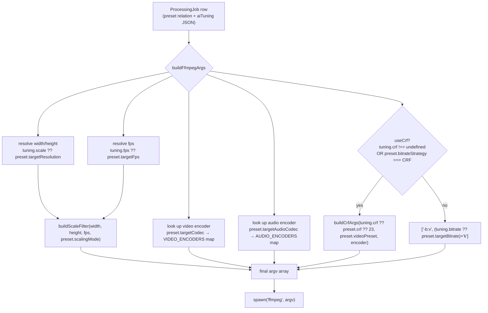

# 05 — FFmpeg Pipeline

Source of truth: [apps/worker/src/ffmpeg/ffmpeg.ts](../../apps/worker/src/ffmpeg/ffmpeg.ts). This document traces exactly how a `PlatformPreset` row + optional `AiTuning` object become a concrete `ffmpeg` argv array.

## Where the WhatsApp Story preset comes from

It is a **static, seeded row** in the `PlatformPreset` table — not computed, not templated. [apps/api/prisma/seed.ts:64-82](../../apps/api/prisma/seed.ts#L64-L82):

```ts
{
  name: 'WhatsApp Story',
  slug: 'whatsapp-story',
  targetResolution: '720x1280',
  targetCodec: 'h264',
  targetFps: 30,
  targetBitrate: 2000,
  targetAudioCodec: 'aac',
  targetAudioBitrate: 128,
  ...DEFAULT_PROFILE_FIELDS,     // pixelFormat: yuv420p, container: mp4, audioChannels: 2, audioSampleRate: 44100, scalingMode: pad, optimizationFlags: [-movflags +faststart]
  crf: 23,                       // OVERRIDES DEFAULT_PROFILE_FIELDS.crf (null)
  bitrateStrategy: 'CRF',        // OVERRIDES DEFAULT_PROFILE_FIELDS.bitrateStrategy (CBR)
  videoPreset: 'slow',           // OVERRIDES DEFAULT_PROFILE_FIELDS.videoPreset (veryfast)
}
```

This is the **only** preset (of 9) that overrides `bitrateStrategy`/`crf`/`videoPreset` from the shared defaults — every other platform (Instagram, TikTok, Telegram, Discord, YouTube Shorts, etc.) uses flat CBR at `veryfast`. The seed comment explains the reasoning: WhatsApp re-compresses every Story after upload, so CRF (which allocates bits adaptively per-frame based on complexity, rather than a fixed rate) is meant to hand WhatsApp's own compression pass a higher-quality source to work from. This value is written to Postgres once, at `pnpm db:seed` time; the worker reads it fresh from the DB on every job (via `record.preset` in [process-video.processor.ts:29](../../apps/worker/src/processors/process-video.processor.ts#L29)), so changing it requires re-seeding (or editing via SQL — there is no admin UI wired to actually mutate presets, see [10-quality-review.md](./10-quality-review.md)).

## The full pipeline: PlatformPreset (+ AiTuning) → ffmpeg argv



### 1. Resolution / scale — [buildFfmpegArgs:104](../../apps/worker/src/ffmpeg/ffmpeg.ts#L104), [buildScaleFilter:76-90](../../apps/worker/src/ffmpeg/ffmpeg.ts#L76-L90)

`tuning?.scale ?? preset.targetResolution` is parsed with `parseResolution` (`/^(\d+)x(\d+)$/`, throws `FfmpegError` on malformed input). The width/height then feed a `-vf` filter chain that differs by `preset.scalingMode`:

- **`pad`** (default, used by every current preset including WhatsApp Story): `scale=W:H:force_original_aspect_ratio=decrease:force_divisible_by=2,pad=W:H:(ow-iw)/2:(oh-ih)/2,fps=F` — downscales to fit **inside** the target box preserving aspect ratio, then letterboxes/pillarboxes the remainder with black bars to hit the exact target dimensions.
- **`crop`** (opt-in per profile, not used by any seeded preset today): `scale=W:H:force_original_aspect_ratio=increase:force_divisible_by=2,crop=W:H,fps=F` — upscales/downscales to **cover** the target box, then crops the overflow. No preset currently uses this.

`force_divisible_by=2` is required because most H.264/H.265 encoders reject odd dimensions for 4:2:0 chroma subsampling — this is a correctness necessity, not a quality choice.

### 2. FPS — same `tuning?.fps ?? preset.targetFps` pattern, folded into the same `-vf` chain (`fps=F` is the last stage of the filter, applied *after* scaling).

### 3. Codec selection — [VIDEO_ENCODERS](../../apps/worker/src/ffmpeg/ffmpeg.ts#L46-L51) / [AUDIO_ENCODERS](../../apps/worker/src/ffmpeg/ffmpeg.ts#L53-L57)

```
h264/h265/hevc/vp9  →  libx264 / libx265 / libx265 / libvpx-vp9
aac/opus/mp3         →  aac / libopus / libmp3lame
```

An unmapped `targetCodec` or `targetAudioCodec` throws `FfmpegError` immediately — no silent fallback to a default encoder.

### 4. Bitrate strategy: CRF vs CBR — [buildFfmpegArgs:119-122](../../apps/worker/src/ffmpeg/ffmpeg.ts#L119-L122), [buildCrfArgs:152-163](../../apps/worker/src/ffmpeg/ffmpeg.ts#L152-L163)

```ts
const useCrf = tuning?.crf !== undefined || preset.bitrateStrategy === 'CRF';
```

**`tuning.crf` being present always wins, unconditionally** — even if the chosen platform profile is a pure-CBR platform, an explicit AI Fine-Tune CRF override switches that one job into CRF mode. This is a deliberate architectural rule (documented in the function's own comment, [ffmpeg.ts:92-97](../../apps/worker/src/ffmpeg/ffmpeg.ts#L92-L97)) and is unit-tested ([ffmpeg.test.ts:130-142](../../apps/worker/src/ffmpeg/ffmpeg.test.ts#L130-L142)).

- **CRF mode**: `-crf {n} -preset {videoPreset}` for `libx264`/`libx265` (the only two encoders in `PRESET_FLAG_ENCODERS`); for `libvpx-vp9`, `-preset` is **not** a valid flag, so instead `-b:v 0` is appended alongside `-crf` (VP9's documented constant-quality mode requirement). `n` resolves as `tuning?.crf ?? preset.crf ?? DEFAULT_CRF(23)` — if a CBR-only preset gets `tuning.crf` but has no `preset.crf` baseline of its own (`crf: null` in the DB), the hardcoded fallback `23` is used, not derived from `targetBitrate` in any way.
- **CBR mode**: `-b:v {n}k`, `n` resolves as `tuning?.bitrate ?? preset.targetBitrate`. **No `-maxrate`/`-bufsize` are ever set** — this is a true unconstrained one-pass average-bitrate encode, not a capped VBV-constrained CBR (see [11-video-quality-analysis.md](./11-video-quality-analysis.md)).
- There is **no two-pass encoding anywhere in the codebase** — every encode, CRF or CBR, is single-pass.

### 5. Pixel format, audio, container, optimization flags

Appended unconditionally from the preset (never overridden by tuning, since `AiTuning` has no fields for them):
```
-pix_fmt {preset.pixelFormat}       (all presets: yuv420p)
-c:a {audioEncoder} -b:a {preset.targetAudioBitrate}k
-ac {preset.audioChannels}          (all presets: 2)
-ar {preset.audioSampleRate}        (all presets: 44100)
...preset.optimizationFlags          (all presets: -movflags +faststart)
```
`optimizationFlags` is a raw `string[]` spread directly into argv — it's whatever the DB row contains, with no validation of its contents at the ffmpeg-arg-building layer (a bad value here would only surface as an ffmpeg exit-code failure at encode time).

### 6. Full final argv (WhatsApp Story example, no AI tuning)

```
-y -v error
-i <inputPath>
-vf scale=720:1280:force_original_aspect_ratio=decrease:force_divisible_by=2,pad=720:1280:(ow-iw)/2:(oh-ih)/2,fps=30
-c:v libx264
-crf 23 -preset slow
-pix_fmt yuv420p
-c:a aac -b:a 128k
-ac 2 -ar 44100
-movflags +faststart
-progress pipe:1
<outputPath>
```

`-progress pipe:1` streams machine-readable `key=value` progress lines to stdout, parsed by `parseProgressPercent` ([ffmpeg.ts:169-188](../../apps/worker/src/ffmpeg/ffmpeg.ts#L169-L188)): `out_time_us=<n>` is converted to a percentage of `durationSeconds` (the source video's duration, from `MediaFile.duration`, i.e. ffprobe's earlier reading — **not** the output duration, which is assumed identical since no trimming ever happens), capped at 99% until `progress=end` arrives (guarantees the UI never shows 100% before the process actually exits).

## AI tuning overrides — exactly what can and cannot change

`AiTuning` ([ffmpeg.ts:31-36](../../apps/worker/src/ffmpeg/ffmpeg.ts#L31-L36)) has **exactly four optional fields**: `crf`, `bitrate`, `fps`, `scale`. This is enforced at three independent layers, all of which would need to change in lockstep for this to be violated:
1. **API DTO** — [apps/api/src/processing/dto/ai-tuning.dto.ts](../../apps/api/src/processing/dto/ai-tuning.dto.ts) only declares these four `@IsOptional()` properties; the global `ValidationPipe({ whitelist: true })` strips anything else the client sends.
2. **Recommendation engine** — [apps/api/src/ai/recommendation.engine.ts](../../apps/api/src/ai/recommendation.engine.ts)'s `suggestTuning()` return type (`TuningSuggestion`) only has `suggestedCrf`/`suggestedBitrate`/`suggestedFps`/`suggestedScale`.
3. **ffmpeg arg builder** — as shown above, `tuning` is only ever read for these four fields; codec, container, audio settings, pixel format, and scaling *mode* (pad vs crop) are always sourced from the preset, never from tuning.

This means AI (deterministic or, hypothetically, a future LLM) is **structurally incapable** of changing which encoder is used, the container/extension, or audio parameters — it can only nudge quality/size/motion-smoothness knobs on top of a platform's own profile. This matches the product requirement from the architecture pivot ("AI must NOT replace the platform profile").

## What quality parameters are *not* configurable anywhere in the system

- `-tune` (e.g. `film`, `grain`, `animation`) — never set.
- Encoder-specific psychovisual flags (`-x264-params`, `psy-rd`, `aq-mode`, etc.) — never set; libx264 defaults are used as-is.
- Deblocking filter strength — never set.
- GOP size / keyframe interval (`-g`, `-keyint_min`) — never set, so ffmpeg's encoder default applies (for libx264 this is typically ~250 frames / ~10s at 30fps, unrelated to WhatsApp's segment/keyframe expectations for short Stories).
- Two-pass / `-pass 1`/`-pass 2` — never used.
- `-crf` is never combined with a `-maxrate`/`-bufsize` cap, so a CRF encode of a very high-complexity clip can spike well above `targetBitrate` with nothing preventing it.

See [11-video-quality-analysis.md](./11-video-quality-analysis.md) for which of these gaps most plausibly explains a quality gap against a competitor product.
