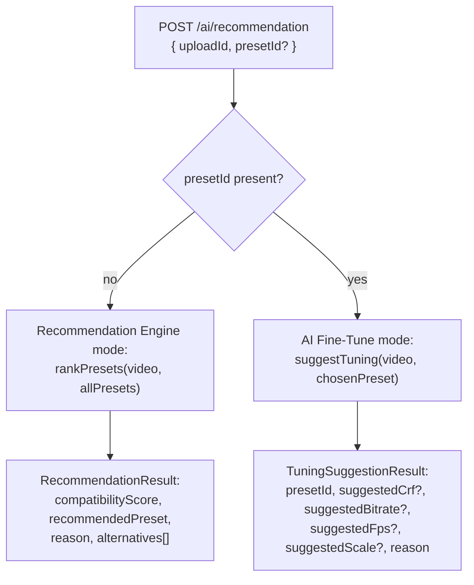
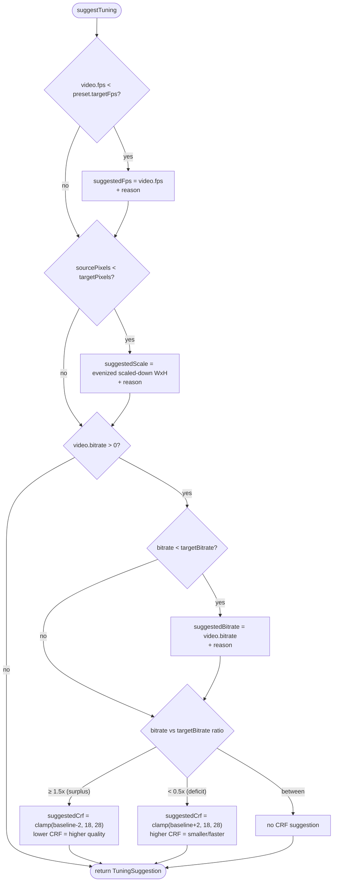

# 06 — AI

## There is no LLM

Despite the product-facing name "AI," [apps/api/src/ai/](../../apps/api/src/ai/) contains no call to any external model, no API key for OpenAI/Gemini/Anthropic/etc., and no `fetch`/SDK call of any kind. It is entirely `apps/api/src/ai/recommendation.engine.ts` — pure, synchronous, deterministic TypeScript functions with weighted arithmetic. Confirmed by reading every file in the module: `ai.module.ts`, `ai.controller.ts`, `ai.service.ts`, `ai.repository.ts` (three Prisma lookups only), and the engine itself. Same input always produces the same output; there is nothing to prompt-engineer, nothing that calls out to a network service, and no non-determinism to worry about in tests.

## Two modes behind one endpoint

`POST /ai/recommendation` ([apps/api/src/ai/ai.controller.ts](../../apps/api/src/ai/ai.controller.ts)) branches purely on whether the request body includes `presetId`:

Both modes share the same precondition checks in `AiService.recommend` ([ai.service.ts:54-63](../../apps/api/src/ai/ai.service.ts#L54-L63)): the `Upload` must exist (404), must have a `MediaFile` (400), and that `MediaFile`'s metadata must be "ready" — defined narrowly as `width > 0 && height > 0` ([ai.service.ts:124-126](../../apps/api/src/ai/ai.service.ts#L124-L126)), i.e. ffprobe has run at least once. This is why the frontend retries on `400` — see [07-frontend.md](./07-frontend.md).

## Mode 1: Recommendation Engine (legacy, still implemented, no longer called by the frontend)

`rankPresets(video, presets)` → `scorePreset` for every preset → sort descending by score, tie-broken by slug for determinism ([recommendation.engine.ts:250-254](../../apps/api/src/ai/recommendation.engine.ts#L250-L254)).

`scorePreset` computes 7 independent factor scores (0–100 each), each weighted, summed, and normalized:

| Factor | Weight | What it measures |
|---|---|---|
| `aspectRatio` | 30 | How close source W/H ratio is to target ratio. Perfect match (≤2% relative diff) = 100. Score decays linearly to 0 at 70% relative difference. |
| `resolution` | 20 | `sourcePixels / targetPixels`. ≥1 (source has enough pixels) = 100. Below that, score = `sqrt(ratio) * 100` (upscaling-risk penalty, softened by sqrt). |
| `bitrate` | 20 | Source bitrate vs target. ≥ target = 100. Below target, linear ratio. |
| `fps` | 10 | Same linear-ratio pattern as bitrate. |
| `codec` | 10 | Exact match = 100, mismatch = flat 70 (still transcodable, just less efficient — not a real quality signal, just an efficiency note). |
| `duration` | 5 | Only penalized for platforms with a `DURATION_LIMITS_BY_SLUG` entry (`whatsapp-story: 30s`, `youtube-shorts: 60s`). Over the limit, score decays linearly with overshoot ratio. |
| `fileSize` | 5 | Compares source size to an *estimated* output size (`(targetBitrate + targetAudioBitrate) * duration / 8`). Smaller output than source = 100. |

Every factor returns `UNKNOWN_NEUTRAL_SCORE = 50` when the relevant source metadata is `0`/missing — this avoids a metadata gap forcing a factor to 0 (which would then double-punish incomplete ffprobe reads).

Final score: `Math.round(weightedSum / totalWeight)` (0–100). `AiService.recommend` returns the top-scored preset as `recommendedPreset`, its top 2 non-`reasons`-filtered factor explanations joined as `reason` (`buildReason`, [ai.service.ts:128-133](../../apps/api/src/ai/ai.service.ts#L128-L133)), and the next 2 highest as `alternatives`.

This mode is fully covered by [apps/api/src/ai/recommendation.engine.spec.ts](../../apps/api/src/ai/recommendation.engine.spec.ts) and [ai.service.spec.ts](../../apps/api/src/ai/ai.service.spec.ts), and is exercised by the AI controller/DTO, but **no frontend code calls it anymore** — `apps/web/src/services/recommendation-service.ts`'s only export, `fetchAiTuningSuggestion`, always sends `presetId`. The ranking mode is reachable only by a direct API client sending `{ uploadId }` without `presetId`.

## Mode 2: AI Fine-Tune (current default, product-facing)

`suggestTuning(video, preset)` ([recommendation.engine.ts:287-331](../../apps/api/src/ai/recommendation.engine.ts#L287-L331)) — takes the video metadata **and the single already-chosen preset**, returns up to 4 concrete suggested values plus human-readable reasons. It deliberately reuses the same delta logic as the scoring factors above, just translated into concrete numbers instead of a 0–100 score:

Rules, precisely:

1. **FPS**: if `video.fps < preset.targetFps`, suggest `suggestedFps = video.fps` — i.e. *never* suggest interpolating fps upward; only ever suggest dropping the target to match what the source actually has (avoids encoding motion-interpolated/duplicated frames).
2. **Scale**: if `sourcePixels < targetPixels` (source has fewer total pixels than the platform target), suggest a **smaller** scale — computed as `target dimensions × sqrt(sourcePixels/targetPixels)`, then `evenize()`d (force down to the nearest even number, required by the `force_divisible_by=2` ffmpeg filter). This avoids upscaling a low-res source to the platform's full target resolution, which would encode invented detail as if it were real.
3. **Bitrate**: if `video.bitrate < preset.targetBitrate`, suggest `suggestedBitrate = video.bitrate` (only relevant if the preset ends up in CBR mode via tuning — WhatsApp Story itself is CRF by default, where `suggestedBitrate` for it is effectively inert unless something forces CBR).
4. **CRF**: the baseline is `preset.crf ?? 23` (`CRF_BASELINE`). If source bitrate is ≥ 1.5× (`BITRATE_SURPLUS_RATIO`) the target — meaning the source is comparatively uncompressed / detail-rich relative to what the platform normally expects — suggest lowering CRF by 2 (higher quality, since there's "room" to preserve more detail). If source bitrate is < 0.5× (`BITRATE_DEFICIT_RATIO`) the target — the source is already heavily compressed — suggest raising CRF by 2 (there's no real detail left to preserve, so save bits instead). Both suggestions are clamped to `[18, 28]` (`CRF_MIN`/`CRF_MAX`) regardless of the arithmetic, so AI Fine-Tune can never push a CRF outside that band even for a wildly divergent source bitrate.

If none of the four conditions trigger (source already fits the target well on every axis), `suggestTuning` returns an object with all four `suggested*` fields `undefined` and an empty `reasons` array — `AiService.recommendTuning`'s `buildReason` then returns `"Video sudah sangat sesuai dengan {presetName}."` ([ai.service.ts:129-131](../../apps/api/src/ai/ai.service.ts#L129-L131)), and the frontend shows "tidak ada perubahan diperlukan" ([ai-fine-tune-toggle.tsx:117](../../apps/web/src/components/ai-fine-tune-toggle.tsx#L117)).

## Where AI affects encoding

Exactly the four fields listed above, merged into the ffmpeg argv only at [apps/worker/src/ffmpeg/ffmpeg.ts:104-122](../../apps/worker/src/ffmpeg/ffmpeg.ts#L104-L122) — see [05-ffmpeg.md](./05-ffmpeg.md) for the exact merge rules, including the "an explicit `tuning.crf` always forces CRF mode even on a CBR-default platform" rule.

## Where AI does NOT affect encoding

- **Platform/preset selection** — the user always picks the platform explicitly via `PlatformPicker` (or accepts the WhatsApp Story default); `suggestTuning` receives the preset as an input, never returns one.
- **Codec** (`targetCodec`/`targetAudioCodec`) — not a field on `AiTuning` at all.
- **Container/extension** (`preset.container`) — not a field on `AiTuning`.
- **Pixel format, audio channels, audio sample rate, `videoPreset` (x264 speed/quality), `optimizationFlags`, `scalingMode` (pad vs crop)** — none of these are fields on `AiTuning`; all always come straight from the chosen `PlatformPreset` row regardless of whether AI Fine-Tune is on.

## UX pattern: "silent toggle," not raw sliders

The product deliberately never exposes CRF/bitrate/fps/scale as editable inputs to the end user — `AiFineTuneToggle` ([apps/web/src/components/ai-fine-tune-toggle.tsx](../../apps/web/src/components/ai-fine-tune-toggle.tsx)) is a single on/off switch; when on, it fetches the suggestion, applies it automatically (no confirm step), and shows a plain-language summary + "Reset ke default platform" escape hatch. See [07-frontend.md](./07-frontend.md) for the component wiring.
