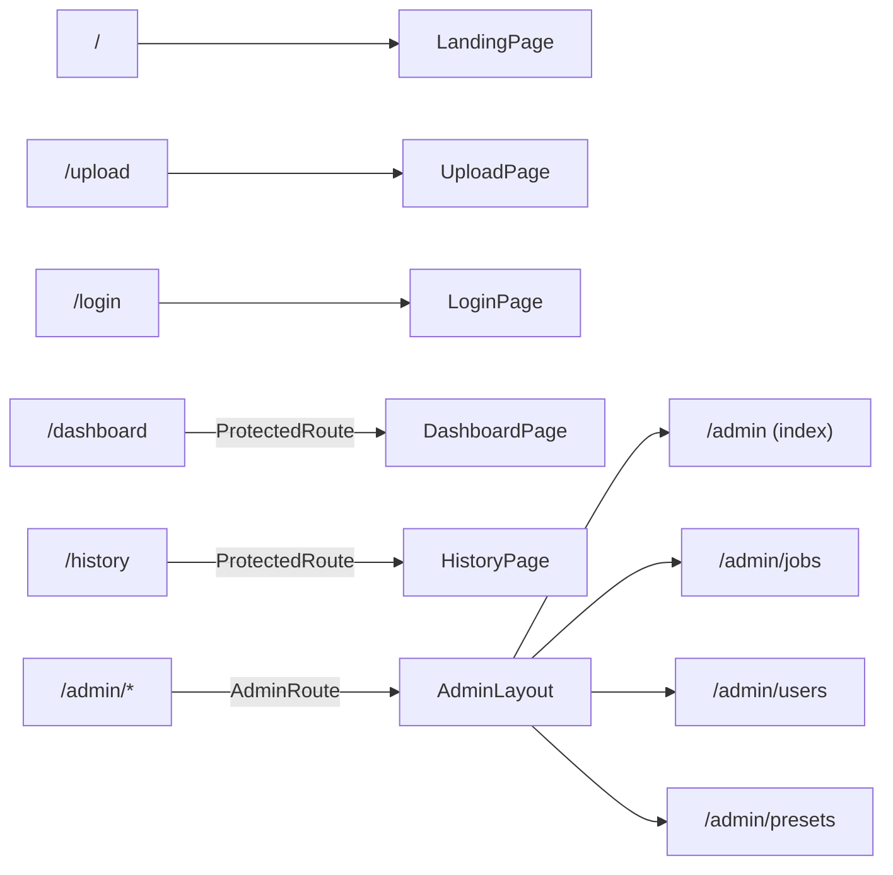
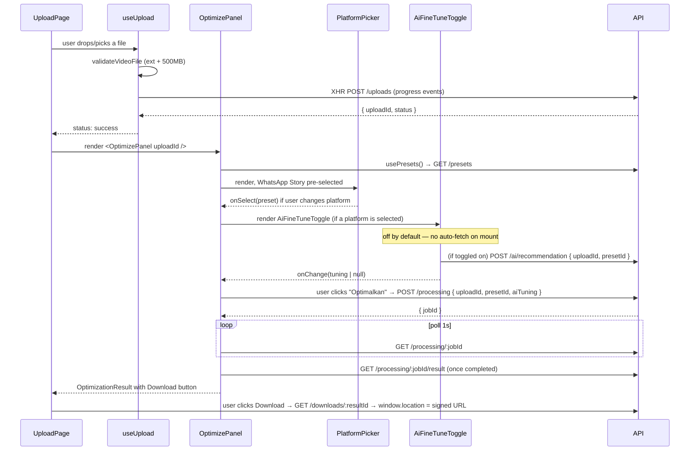

# 07 — Frontend (apps/web)

React 19 + Vite 6 SPA. Tailwind CSS 4 (via `@tailwindcss/vite`, no separate config file compilation step). No Redux — global client state is Zustand, server state is TanStack Query. No `packages/ui` usage despite the package existing — every primitive in `src/components/ui/` is local.

## Routing ([src/App.tsx](../../apps/web/src/App.tsx))

- `/upload` has **no** `ProtectedRoute` — uploading and optimizing works fully as a guest (matches `OptionalJwtAuthGuard` on the backend `uploads`/`downloads` controllers).
- `ProtectedRoute` ([protected-route.tsx](../../apps/web/src/components/protected-route.tsx)) only checks `useAuthStore().token !== null` — a **client-side-only** gate; it does not verify the token is still valid/unexpired, that check happens lazily when an actual API call 401s.
- `AdminRoute` ([admin-route.tsx](../../apps/web/src/components/admin-route.tsx)) is stricter: it waits for `useCurrentUser()` to resolve and checks `user.role === 'ADMIN'` — so unlike `ProtectedRoute`, it does make a server round-trip before rendering, and is the only route that actually verifies a role server-side before showing UI (the `/admin/*` API endpoints are separately guarded server-side regardless, so this is UX-only, not a security boundary by itself).
- `useTheme()` is called once at the top of `App()`, outside any route, so `.dark` on `<html>` is correct even on `/login` which renders no `AppHeader`.

## Server state: TanStack Query hooks

Every hook in `src/hooks/` is a thin `useQuery`/`useMutation` wrapper around one `src/services/*` function. Pattern is completely uniform — no hook contains fetch logic itself.

| Hook | Wraps | Notes |
|---|---|---|
| `usePresets()` | `fetchPresets` | `staleTime: Infinity` — presets are treated as effectively static for the session; a preset added server-side won't appear without a full reload |
| `useCreateProcessing()` | `createProcessingJob` | mutation; `data.jobId` drives the two queries below |
| `useProcessingStatus(jobId)` | `fetchProcessingStatus` | polls every 1s (`STATUS_POLL_INTERVAL_MS`) via `refetchInterval`, **stops polling** once `status` is `'completed'` or `'failed'` (checked inside the `refetchInterval` callback itself, not a separate `enabled` condition) |
| `useProcessingResult(jobId, enabled)` | `fetchProcessingResult` | only enabled once status is `completed` |
| `useDownloadResult()` | `fetchProcessingResult` | mutation whose `onSuccess` does `window.location.assign(downloadUrl)` — a real browser navigation to the signed URL, not a fetch+blob download |
| `useAiFineTune(uploadId, presetId, enabled)` | `fetchAiTuningSuggestion` | only runs when the toggle is on; retries up to 5× at 1.5s intervals **only** on `ApiError` with `status === 400` (metadata-not-ready race — see below), any other error fails immediately |
| `useHistory(params)` / `useDeleteHistory()` | history service | — |
| `useCurrentUser()` | `fetchCurrentUser` (`GET /auth/me`) | `enabled: token !== null` — never fires for a guest |
| `useGoogleLogin()` / `useLogout()` | auth service | on success, `useGoogleLogin` writes to `authStore` and navigates to `/dashboard`; `useLogout` clears the store, evicts the `['auth','me']` cache entry, navigates to `/login` **regardless of whether the server call succeeded** (`onSettled`, not `onSuccess`) — consistent with the backend's stateless-JWT logout being a no-op anyway |
| `useAdmin*` hooks | admin service | role-gated server-side, not client-side beyond the route guard |

## The upload → optimize → download flow

### `useUpload` — [src/hooks/use-upload.ts](../../apps/web/src/hooks/use-upload.ts)

A 4-state machine (`idle`/`uploading`/`success`/`error`) built on a raw `XMLHttpRequest` (not `fetch`, because `fetch` still has no standard upload-progress event as of this codebase's usage — [upload-service.ts](../../apps/web/src/services/upload-service.ts)). `cancel()` calls `xhr.abort()`, which the service translates into a distinguishable `UploadCancelledError` so the hook can silently return to `idle` instead of showing an "upload failed" error for a user-initiated cancel. `retry()` replays the same `File` object held in state — no re-picking required.

### `OptimizePanel` — [src/components/optimize-panel.tsx](../../apps/web/src/components/optimize-panel.tsx)

The step orchestrator for everything after a successful upload. Key state:
- `selectedPresetId` (raw user choice, starts `''`) combined with a **derived** `defaultPresetId` (first match of `whatsapp-story` in the loaded preset list, or the first preset if that's missing) into `effectiveSelectedId = selectedPresetId || defaultPresetId` — computed inline during render, not via a `useEffect` + separate state, avoiding an extra render/flash before the default appears.
- `aiTuning` — reset to `null` whenever the platform selection changes (`selectPlatform`, [optimize-panel.tsx:83-87](../../apps/web/src/components/optimize-panel.tsx#L83-L87)), since a tuning suggestion computed for one platform is meaningless for another.
- Once `createProcessing.isSuccess`, the component permanently switches to a **result-only render branch** ([optimize-panel.tsx:105](../../apps/web/src/components/optimize-panel.tsx#L105)) — there's no way to go "back" to platform selection without the parent (`UploadPage`) fully resetting via `onReset` (which re-uploads from scratch, since state isn't preserved across an upload/optimize cycle for a *different* platform on the same file).
- `processingTimeSeconds` is a **client-side wall-clock estimate** (`Date.now()` at job creation to `Date.now()` at first-observed `completed` status), not a value returned by the API — it's separate from the worker's own server-side `processingTime` stored on `ProcessingResult`, which the frontend never displays.

### `PlatformPicker` — [src/components/platform-picker.tsx](../../apps/web/src/components/platform-picker.tsx)

Pure presentational, `role="radiogroup"`/`role="radio"` for accessibility. `PRIMARY_PLATFORM_SLUGS` is a **hardcoded array of 6 slugs** in the component itself (`whatsapp-story, instagram-story, tiktok, discord, telegram, youtube-shorts`) — the primary/secondary split is a frontend-only concept; the backend has no notion of "primary" vs "secondary" preset. The remaining 3 presets (`whatsapp-chat`, `instagram-reels`, `facebook-story`) render inside a native `
` element under "Platform lainnya" — fully functional, just collapsed by default, using a zero-JS disclosure widget rather than component state.

### `AiFineTuneToggle` — [src/components/ai-fine-tune-toggle.tsx](../../apps/web/src/components/ai-fine-tune-toggle.tsx)

A single `role="switch"` button, `isOn` local state, **off by default**. Turning it on triggers `useAiFineTune(uploadId, presetId, isOn)`. A `useEffect` (deliberately depending on the raw `onChange` setter function reference — see below) propagates the result up: `isOn === false` → `onChange(null)`; `isOn === true` and data has arrived → `onChange({ crf, bitrate, fps, scale })` built from whatever fields the suggestion actually returned (`undefined` fields pass through as `undefined`, which the JSON body serializer / DTO validator on the backend treats as "not provided").

**Notable React pattern**: `OptimizePanel` passes `onChange={setAiTuning}` — the raw `useState` setter, not a wrapped inline arrow function — specifically so its reference stays stable across parent re-renders, letting the child's `useEffect` safely list `onChange` in its dependency array without triggering an infinite effect loop (a wrapped `onChange={(t) => setAiTuning(t)}` would create a new function every render and re-fire the effect every render).

Turning the toggle off calls `onChange(null)` synchronously in the same effect — there is **no explicit "cancel in-flight request"** if the query hasn't resolved yet by the time the user flips it off; TanStack Query's own `enabled: false` transition handles that by simply not using the (now-orphaned) result when it resolves.

### Retry-on-400 pattern (metadata race)

Both `useAiFineTune` and (implicitly, by the same underlying 400 the AI endpoint returns) the general flow account for the fact that `extract-metadata` runs asynchronously and may not have completed by the time the user reaches the platform/AI step. `useAiFineTune`'s `retry` callback inspects `error instanceof ApiError && error.status === 400`, retrying up to 5 times at a flat 1.5s delay ([use-ai-fine-tune.ts:21-26](../../apps/web/src/hooks/use-ai-fine-tune.ts#L21-L26)) — any other status fails immediately without retrying. **There is no equivalent retry for `POST /processing` itself** — if a user manages to click "Optimalkan" before metadata is ready, `ProcessingService.createJob` doesn't actually check metadata readiness at all (only `AiService` does) — see [10-quality-review.md](./10-quality-review.md) for whether this is a real gap.

## Download flow (frontend side)

Two different code paths hit the same backend signed-URL mechanism:
- `OptimizePanel`'s "Download video" button and the history page's inline download button both use `useDownloadResult()`, whose `mutationFn` is `fetchProcessingResult` (i.e. `GET /processing/:jobId/result`) — this goes through `ProcessingService.getResult`, which (per [03-backend.md](./03-backend.md)) **always calls `createSignedDownload` with `userId: null`**, so these downloads are never recorded in `Download` history regardless of login state.
- Nothing in the frontend calls `GET /downloads/:resultId` directly — so in the current wiring, the "record a download in history" code path on the backend is effectively **dead from the frontend's perspective** (reachable, tested, but never actually invoked by the shipped UI).

## Admin pages

Read-only across the board. `AdminPresetsPage` explicitly documents in its own comment that preset editing is intentionally out of scope — "Preset ini dikelola langsung dari database, bukan dari halaman ini" ([admin-presets-page.tsx:6-8](../../apps/web/src/pages/admin/admin-presets-page.tsx#L6-L8)) — matching the fact that no `PUT`/`PATCH /admin/presets` endpoint exists server-side either. This is a **consistent, intentional constraint**, not a gap (the docs' "Never: Mengubah Database Schema tanpa instruksi" / CLAUDE.md's caution against new endpoints is being honored here).

## Theming

`useThemeStore` (Zustand + `persist`, key `forkekan-theme`) holds `'light' | 'dark' | 'system'`. `useTheme()` ([src/hooks/use-theme.ts](../../apps/web/src/hooks/use-theme.ts)) applies/removes the `.dark` class on `document.documentElement`, and for `'system'` subscribes to `matchMedia('(prefers-color-scheme: dark)')` changes live. `index.html` has an inline blocking `<script>` that reads `localStorage` directly and sets the class **before** React hydrates, preventing a flash of the wrong theme on load.

## Notable absences

- No client-side routing guard prevents a guest from reaching `/upload` and running a full optimize+download cycle — this is intentional (guest flow is a first-class supported path per `docs/03-user-flow.md`).
- No error boundary component anywhere in `src/` — an uncaught render error in any page produces the default blank-white-screen React failure, not a graceful fallback UI.
- No thumbnail/preview player anywhere in the result UI (`OptimizationResult` only shows resolution/codec/size/optional compatibility score/processing time) — consistent with the backend never generating a `previewThumbnail` (see [04-worker.md](./04-worker.md)).
