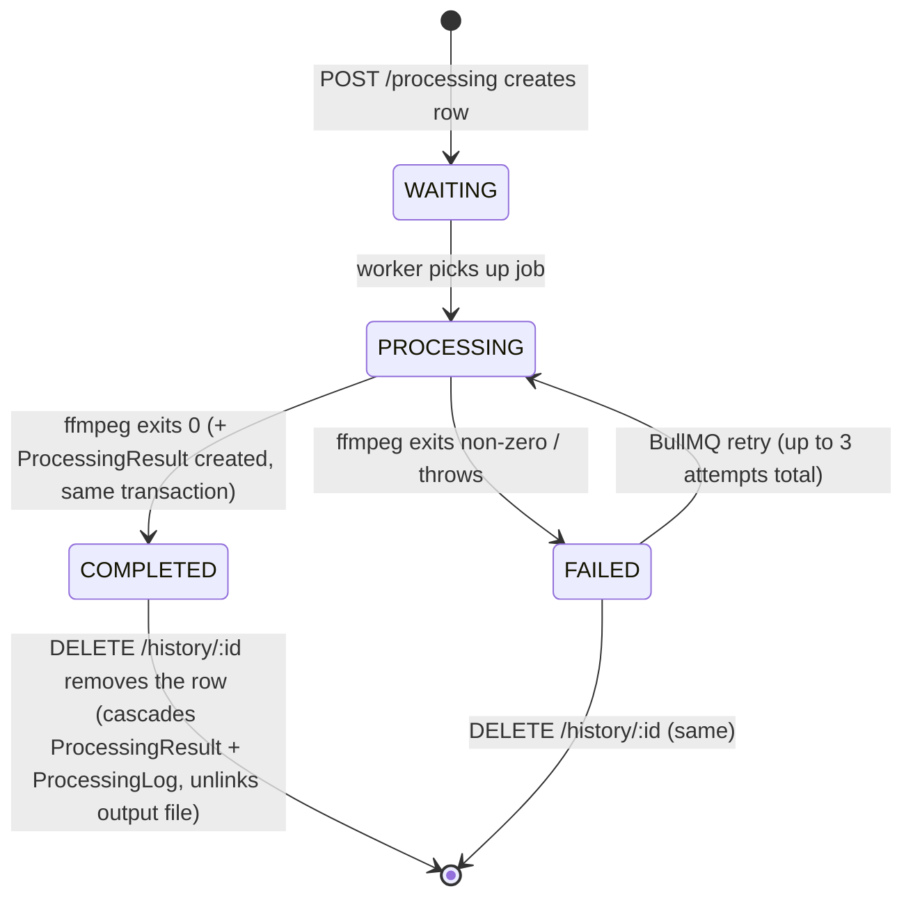

# 08 — Database

PostgreSQL via Prisma 6. Schema: [apps/api/prisma/schema.prisma](../../apps/api/prisma/schema.prisma). All IDs are `cuid()` strings (not auto-increment integers, despite `docs/07-api-specification.md`'s JSON examples showing `"id": 1`).

## ER diagram

```mermaid
erDiagram
    User ||--o{ Upload : "uploads"
    User ||--o{ Download : "downloads"
    User ||--o{ FavoritePreset : "favorites"
    Upload ||--o| MediaFile : "has one"
    MediaFile ||--o| StorageObject : "has one"
    MediaFile ||--o{ ProcessingJob : "processingJobs"
    PlatformPreset ||--o{ ProcessingJob : "processingJobs"
    PlatformPreset ||--o{ FavoritePreset : "favorites"
    ProcessingJob ||--o| ProcessingResult : "result"
    ProcessingJob ||--o{ ProcessingLog : "logs"
    ProcessingResult ||--o{ Download : "downloads"

    User {
        string id PK
        string name
        string email UK
        string avatarUrl
        string provider
        string providerId UK
        UserRole role
    }
    Upload {
        string id PK
        string userId FK "nullable — guest uploads"
        UploadStatus status
        string ipAddress
        string userAgent
    }
    MediaFile {
        string id PK
        string uploadId FK UK
        string originalFilename
        string storedFilename
        bigint fileSize
        int width
        int height
        float duration
        float fps
        int bitrate
        string codec
        string audioCodec
        int audioBitrate
    }
    StorageObject {
        string id PK
        string mediaFileId FK UK
        string disk
        string bucket
        string objectKey
        string visibility
    }
    PlatformPreset {
        string id PK
        string name
        string slug UK
        string description
        string targetResolution
        string targetCodec
        float targetFps
        int targetBitrate
        string targetAudioCodec
        int targetAudioBitrate
        int crf "nullable"
        BitrateStrategy bitrateStrategy
        string pixelFormat
        string container
        string videoPreset
        string_array optimizationFlags
        int audioChannels
        int audioSampleRate
        string scalingMode
    }
    ProcessingJob {
        string id PK
        string mediaFileId FK
        string presetId FK
        string queueName
        string workerName "nullable"
        JobStatus status
        int progress
        json aiTuning "nullable"
        string failedReason "nullable"
    }
    ProcessingResult {
        string id PK
        string processingJobId FK UK
        string outputFilename
        bigint outputSize
        string outputResolution
        string outputCodec
        int outputBitrate
        int processingTime
        string previewThumbnail "nullable, never populated"
    }
    ProcessingLog {
        string id PK
        string processingJobId FK
        LogLevel level
        string message
    }
    Download {
        string id PK
        string userId FK
        string processingResultId FK
    }
    FavoritePreset {
        string id PK
        string userId FK
        string presetId FK
    }
```

## Enums

```
UserRole        USER | ADMIN
UploadStatus    UPLOADING | UPLOADED | FAILED
JobStatus       WAITING | PROCESSING | COMPLETED | FAILED
LogLevel        INFO | WARNING | ERROR
BitrateStrategy CBR | CRF
```

`UploadStatus.UPLOADING` and `UploadStatus.FAILED` are declared but never assigned anywhere in the code — `UploadsRepository.createUploadedVideo` always writes `UploadStatus.UPLOADED` directly ([uploads.repository.ts:41](../../apps/api/src/uploads/uploads.repository.ts#L41)), since the Multer interceptor has already finished writing the file to disk (synchronously, from the request handler's point of view) before this row is created — there's no earlier "upload in progress" DB state to represent, and no code path ever marks an upload as failed after the row exists.

## Model-by-model

### `User`
Google OAuth accounts only (`provider`/`providerId`, unique together in intent though only `providerId` itself is `@unique`). `role` defaults to `USER`; promotion to `ADMIN` has no code path (see [03-backend.md](./03-backend.md)). Cascade: deleting a `User` cascades to `Upload`, `Download`, `FavoritePreset`.

### `Upload`
`userId` is **nullable** — the row for the "guest upload" flow. `status` is effectively always `UPLOADED` in practice (see above). One `Upload` has exactly one `MediaFile` (`@unique` on `MediaFile.uploadId`) — a 1:1 modeled as a 1:many-capped-at-one via a unique foreign key, standard Prisma pattern for optional 1:1.

### `MediaFile`
Metadata from ffprobe. Written with sentinel values (`0`/`"unknown"`) at upload time, overwritten once by `extractMetadataProcessor` — **never updated again**. `fileSize` is `BigInt` (handles files near/above 2^31 bytes cleanly; correctly serialized to a JSON-safe string wherever it crosses an API boundary, e.g. `humanFileSize(Number(...))` in services). Has both a `storageObject` (1:1) and `processingJobs` (1:many) relation.

### `StorageObject`
Models a physical file location abstractly (`disk`/`bucket`/`objectKey`/`visibility`/`checksum`/`expiresAt`) — clearly designed for a future multi-backend storage layer (local disk today, presumably Cloudflare R2 per `docs/11-deployment.md`'s intent). **Currently write-only**: created once at upload time with `disk: 'local'`, and **never read by any repository or service** — nothing in `apps/api` or `apps/worker` queries `StorageObject` to resolve a file path; both apps instead reconstruct paths by joining `UPLOAD_DIR`/`OUTPUT_DIR` env vars with `MediaFile.storedFilename` / `ProcessingResult.outputFilename` directly. `checksum` and `expiresAt` are never set at all.

### `PlatformPreset`
The "Platform Profile" concept (see [05-ffmpeg.md](./05-ffmpeg.md)). 9 rows, seeded, no runtime CRUD. All the encode-shaping fields (`crf`, `bitrateStrategy`, `pixelFormat`, `container`, `videoPreset`, `optimizationFlags`, `audioChannels`, `audioSampleRate`, `scalingMode`) were added in the WhatsApp-Story-first architecture pivot as additive, defaulted columns — a backward-compatible migration (every pre-existing row got the default CBR/veryfast/pad/yuv420p/mp4 behavior automatically). Only `WhatsApp Story` deviates from the shared defaults.

### `ProcessingJob`
The central work-tracking row. `queueName` is stored per-row (always `'video-processing'` today — see [common/queue/queue.constants.ts](../../apps/api/src/common/queue/queue.constants.ts)) rather than being a fixed system constant, which is future-proofing for multiple queues that doesn't have a consumer yet. `workerName` is `null` until a worker actually picks the job up (`worker-{hostname}`). `aiTuning` is an untyped `Json?` column — Prisma provides no schema-level guarantee its shape matches `{crf?, bitrate?, fps?, scale?}`; that contract is enforced entirely in application code (the DTO on write, a blind cast on read — see [04-worker.md](./04-worker.md)). Two indexes: `[status, createdAt]` (supports admin's job listing sorted/filtered by status) and separate single-column indexes on `mediaFileId` and `presetId` (supports the active-job duplicate check and history filtering).

### `ProcessingResult`
1:1 with `ProcessingJob` (`@unique` FK). `previewThumbnail` exists but is **never written** by any code path — see [04-worker.md](./04-worker.md) and [10-quality-review.md](./10-quality-review.md). `outputBitrate` is always populated (`tuning?.bitrate ?? preset.targetBitrate`) even for CRF-mode encodes where the actual achieved bitrate is whatever CRF happened to produce — **this field is the configured target, not a measured value**, and can visibly diverge from the real output file's bitrate for any CRF preset (i.e. WhatsApp Story, the primary product path).

### `ProcessingLog`
Append-only audit trail written by the worker (`INFO` at start, `INFO` at completion, `ERROR` on failure — see [services/processing-log.ts](../../apps/worker/src/services/processing-log.ts)). **Nothing in the API ever reads this table** — no controller, no service exposes `ProcessingLog` rows to any client. It exists purely as an operational/debugging trail currently only accessible via direct DB access.

### `Download`
Records who downloaded which `ProcessingResult`, when. `userId` is **required** (not nullable) — meaning a guest download, by construction, can never produce a `Download` row (there's no `NULL`-userId variant the way `Upload.userId` allows). Combined with the finding in [07-frontend.md](./07-frontend.md) that the shipped frontend never actually calls the endpoint that *would* record a logged-in user's download either, **this table is realistically always empty in the current build**.

### `FavoritePreset`
Fully modeled (unique `[userId, presetId]` pair, cascade deletes both ways) but has **zero corresponding API surface** — no controller, service, or repository references `FavoritePreset` anywhere in `apps/api/src/`. `docs/07-api-specification.md` documents `GET/POST/DELETE /favorites` as if they exist; they do not. This is schema built ahead of a feature that was never implemented.

## Processing lifecycle inside the database



A `ProcessingJob` can also be created and then immediately marked `FAILED` **without ever reaching the queue at all**, if `VideoProcessingQueueService.add()` fails synchronously at enqueue time (Redis unreachable) — see [03-backend.md](./03-backend.md#processing-srcprocessing). This is a valid, reachable `WAITING`-skipped `FAILED` state that the state diagram above doesn't capture as a distinct transition but is real in the code ([processing.service.ts:127-130](../../apps/api/src/processing/processing.service.ts#L127-L130)).

## Migrations

One migration of note beyond the initial schema: `20260717222757_platform_profile_and_ai_tuning` — added the 9 `PlatformPreset` encode-shaping columns (all with defaults, so existing rows didn't need backfilling logic) and the nullable `ProcessingJob.aiTuning` column. Fully additive; no destructive changes, no data loss, matches `CLAUDE.md`'s migration-strategy constraint.
